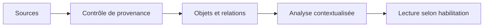

# OSMOSE — veille industrielle pluridisciplinaire

**Présentation de projet pour portfolio professionnel.** Le code source, les règles métier détaillées et les données ne sont pas publiés ici.

OSMOSE explore une veille stratégique où organisations, technologies, réglementations, publications et événements conservent leur identité. Leurs relations sont accompagnées de sources et d'un contexte temporel pour aider à examiner une opportunité ou un risque.

## Objectif

Rendre des signaux dispersés plus lisibles pour les équipes industrielles et leurs décideurs : origine d'une information, liens entre secteurs, éléments contradictoires et évolution dans le temps. Le projet couvre le socle technique ; il ne constitue pas un service commercial déployé ni une collecte mondiale opérationnelle.

## Vue d'ensemble

Le prototype utilise Python et PostgreSQL. Son architecture sépare le domaine, les services applicatifs, les adaptateurs de données et les interfaces. Les frontières d'accès entre informations publiques et propres à un client font partie des sujets de sécurité étudiés.

## Qualité des données

Le socle vérifie les propriétés essentielles des objets et des relations avant leur enregistrement. La collecte de sources, la normalisation des noms, la déduplication et la revue humaine devront être approfondies avant une exploitation réelle.

## État vérifié

220 tests unitaires et d'architecture ont réussi sur une copie locale de référence le 26 novembre 2026. Ce résultat ne valide ni la cybersécurité complète ni la pertinence des analyses pour un client.

## Consultation

Ce dépôt présente uniquement le projet. Le code source et les données restent privés. Aucune licence de réutilisation du projet n'est accordée.
